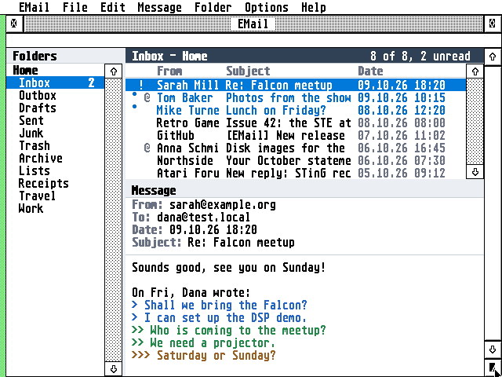
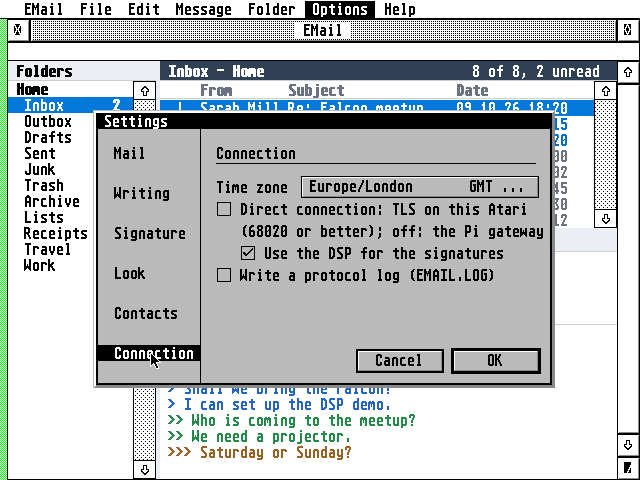

# EMail


An e-mail program for the Atari ST, STE, TT and Falcon, written in C for GEM.

**Highlights**

- **IMAP and POP3 in, SMTP out,** with an Outbox for sending later and copies in Sent.
- **Secure, two ways:** a Raspberry Pi gateway for any Atari, or a **Direct connection**, with TLS 1.2 on the
  Atari itself and RSA on the Falcon's DSP.
- **Hebrew throughout:** UTF-8, ISO-8859-8 and windows-1255 mail, right-to-left layout, the Israeli
  keyboard on F10, Hebrew in vector fonts through NVDI.
- **Works offline:** a mirror of your folders and the messages you've read on disk. Read, flag and move
  offline; the server catches up later.
- **Fast checks:** one go fetches the Inbox and asks every other folder for its counts, so new mail
  filed in Junk or by server rules shows up too.
- **Many messages at once:** select several and mark them read or unread, flag, move or delete them
  together.
- **Folders:** create, rename and delete; an alphabetical folder picker for moving messages.
- **New mail while EMail isn't running:** EMail check (`EMAILCHK.ACC`), a small desk accessory, looks
  in each account's Inbox as often as EMail would and says how many new messages have come; under MiNT
  with BGEM.NG, new mail is a notification with Open and Later, from EMail check and from EMail itself
  while its window is behind.
- **Links that open:** web addresses and an HTML message's links are underlined; a click opens one in
  EWeb (or CAB or HighWire), a `mailto:` one as a new message.
- **Modern but Atari:** one window with draggable panes, right-click menus, colour on 16- and 256-colour
  screens, a Settings dialog with a sidebar, progress on the status line, the guide on the Help key.
- **Any Atari:** TOS 1.04 to 4.x, EmuTOS, MagiC and MiNT, with STinG or MiNTnet, from a 68000 ST in
  medium resolution to a Falcon in 640×480. It runs in TT RAM when the machine has some.



## Getting started

Download the files from the **[latest release](https://github.com/whomper/EMail/releases/latest)**: each
one is there on its own, and all of them together in `EMAIL-x.y.zip`.

| File | What it is |
|---|---|
| `EMAIL.PRG` | the program, for every Atari from the ST to the Falcon |
| `TLS.OVL` | the Direct connection (TLS on a TT or Falcon, RSA on the DSP), loaded only when used; an ST leaves it on the disk |
| `CACERT.PEM`, `ROOTS.DAT` | the root certificates for a Direct connection (Mozilla's list, and the same decoded ahead of time) |
| `EMAIL.HYP`, `EMAIL.REF` | the user guide for EHypView or ST-Guide, opened by the Help key |
| `EMAIL.RSC`, `EMAIL.ICN`, `EMAILMK.ICN` | the desktop icon, on their own and in the zip's `icons/` folder (see [The desktop icon](docs/GUIDE.md#the-desktop-icon)): `EMAIL.RSC` under TOS, EmuTOS, or NVDI with TOS's palette loaded (COLORVDI) |
| `EMAILNV.RSC` | the same desktop icon for NVDI with its own palette, where the 256-colour image is drawn in NVDI's colours |
| `EMAILCHK.ACC` | EMail check: the desk accessory that looks for new mail while EMail isn't running (optional, see [New mail while EMail isn't running](docs/GUIDE.md#new-mail-while-email-isnt-running)) |
| `EMAIL-x.y.zip` | all of the above |

1. Copy `EMAIL.PRG` to any folder on any drive, with `EMAIL.HYP` and
   `EMAIL.REF` beside it (on a TT or Falcon `TLS.OVL` too, for a Direct connection). EMail keeps
   its settings and your mail next to itself, so a folder of its own (`C:\EMAIL\`, say) keeps them
   together; nothing has to be in a particular place.
2. Set up the gateway on a Raspberry Pi from [AERA-Gateway](https://github.com/whomper/AERA-Gateway),
   which brings it to its latest release, with your provider's servers and your Atari's address. On a
   fresh Pi, one line sets up every AERA gateway (the other AERA programs' too):

   ```
   sudo apt install -y git && git clone https://github.com/whomper/AERA-Gateway ~/AERA-Gateway &&
     ~/AERA-Gateway/update-pi.sh --allow ATARI_IP --mail IMAP_SERVER SMTP_SERVER[:587] [POP3_SERVER]
   ```

   Or step by step, the mail gateway alone:

   ```
   sudo apt install -y git                  (Raspberry Pi OS Lite only)
   git clone https://github.com/whomper/AERA-Gateway
   cd AERA-Gateway
   ./update-pi.sh
   sudo gateway/aera-gateway install mail IMAP_SERVER SMTP_SERVER[:587] [POP3_SERVER] --allow ATARI_IP
   ```

   For example `install mail imap.gmail.com smtp.gmail.com pop.gmail.com --allow 192.168.1.20`; iCloud is
   `imap.mail.me.com smtp.mail.me.com:587` (AERA-Gateway's README has the others). `--allow` lets only
   your Atari in; without it, any computer on your home network may use the gateway.
   After `update-pi.sh` has run once, `sudo aera-gateway` works too, from any folder.
   To update: `cd ~/AERA-Gateway && ./update-pi.sh`. To check: `gateway/aera-gateway status`.
3. Start EMail and fill in your account in **Options > Accounts**: the Pi's IP address (`PI_IP`;
   `aera-gateway` prints it) as the server, port 143 for IMAP (110 for POP3) and 587 for SMTP, and your
   login: for Gmail, iCloud, Yahoo and Fastmail an app password (below).
4. Optionally, copy `EMAILCHK.ACC` to the root of the boot drive (`C:\`) and restart: open **EMail
   check** from the Desk menu once and show it `EMAIL.PRG`. From then on it tells you when new mail has
   come while EMail isn't running (under MagiC, MiNT or an AV desktop such as Thing, it offers to open EMail).
5. Press **Help** in EMail for the [user guide](docs/GUIDE.md); it describes everything else.

### App passwords (Gmail, iCloud, Yahoo, Fastmail)

These services refuse the password you use on their website when a program like EMail logs in. Make an
**app password** on the service's website, once, and type it into EMail's Password field, for the
incoming and the outgoing mail, in place of your normal password. Your normal password stays as it is,
and you can delete the app password there at any time.

| Service | First | Where to make it | User in EMail |
|---------|-------|------------------|---------------|
| Gmail | 2-Step Verification on | https://myaccount.google.com/apppasswords (16 letters: type them without the spaces) | your Gmail address |
| iCloud | two-factor authentication | https://account.apple.com, Sign-In and Security, App-Specific Passwords ([Apple's help](https://support.apple.com/en-us/102654)) | incoming: the name before @icloud.com (or the whole address); outgoing: the whole address |
| Yahoo | | Account Security, Create app password under "External connections" ([Yahoo's help](https://help.yahoo.com/kb/SLN15241.html)) | your Yahoo address |
| Fastmail | not the Basic plan | Settings, Privacy & Security, Manage app passwords and access ([Fastmail's help](https://www.fastmail.help/hc/en-us/articles/360058752854)) | your Fastmail address |

The user guide's [App passwords](docs/GUIDE.md#app-passwords-gmail-icloud-yahoo-fastmail) has the steps for each.

On a Falcon or TT with 4 MB you can skip the Pi: copy `TLS.OVL`, `CACERT.PEM` and `ROOTS.DAT` next to
`EMAIL.PRG` and switch on **Options > Direct connection**. EMail fills in the servers for the big providers.

**Updating:** copy the new release's files over the old ones. `EMAIL.INF`, `EMAIL.KEY` and your mail stay
as they are. Coming from 1.55 or before on an ST, delete `EMAILST.PRG`: `EMAIL.PRG` is for every Atari now. On the Pi, `./update-pi.sh` in `AERA-Gateway` updates the gateway.

**Needs:** TOS 1.04 or newer (TOS 4 on the Falcon), EmuTOS, MagiC or MiNT; 640×200 (ST medium) or
larger; 1 MB of memory (EMail itself takes about 332 KB, and about 140 KB more on a TT or Falcon while
`TLS.OVL` is loaded for a Direct connection; more memory holds bigger folders; the accessory EMail check about 180 KB more), 2 MB or more with
EContact's accessory (on a 1 MB ST, use EContact as a program, `ECONTACT.PRG`); network: STinG (or STiK), MiNTnet or
MagiC-Net; for providers that need encryption (nearly all), the Pi gateway or a Direct connection (a
Falcon or TT, a 68020 or better, with 4 MB or more).

**Under TOS, put Atari's `FOLDR100.PRG` first in `AUTO`**, renamed for more room (`FOLDR400.PRG`).
TOS keeps an entry in a small internal pool for every folder a program or accessory has looked
into, and halts with "OUT OF INTERNAL MEMORY" when it runs out; FOLDRxxx makes the pool bigger.

**With STinG, set the Delay in `STING.CPX` to suit the machine:** 10 on a
Falcon or TT, 25 to 50 on an ST, as STinG's manual says. STinG looks at the network card that
often, so it sets the speed of every STinG program: on Erez's Falcon with a NetUSBee, Delay 10
took EFTP's downloads from 40 to 75 KB/s.

### In more detail

- A folder's messages in one file on disk, written in one go at the end of a check or a download (few
  file opens on an Atari hard disk); a message cut short by a reset is fetched again
- IMAP with a local mirror: headers of the newest messages and every message you've read, kept in step
  with the server; big folders load 100 messages at a time, with "Load more" for older ones. Read and
  flag changes are sent in one go when you pause, and at the latest on quit
- POP3 that downloads into local folders and never fetches a message twice
- SMTP with login (AUTH PLAIN/LOGIN); Send now goes straight out, with anything waiting in the Outbox
- Reply, reply to all, forward (with the original's attachments), flags, move (or drag messages onto a
  folder), delete to Trash, mark a whole folder read, one signature of up to four lines for every account
- People by name from EContact, the AERA address book: in the list, the message and the To: line,
  with the address in a tooltip; Ctrl+B picks people and groups in EContact's window. Where EContact
  runs only now and then (short of memory), EMail can read its `CONTACTS.TXT` instead (Settings > Contacts)
- Attachments: save them with the file selector; attach files when writing
- Calendar invitations go to ECal, the AERA calendar: double-click one and ECal's New Event dialog
  opens filled in from it
- HTML-only mail shown as text
- Dates with the year, numbers with thousands separators
- Fonts: the system font in two sizes and any monospaced GDOS font (bitmap, Speedo, TrueType); the
  selector lists only the fonts EMail can use. A vector font's Hebrew letters are found through NVDI 5
  by Unicode (FreeMono and Liberation Mono have them); a font without them gets its Hebrew drawn in the
  system font
- Your time zone by name (Asia/Jerusalem, Europe/London...), with summer time worked out by itself and
  found from the machine when it says
- Passwords encrypted in `EMAIL.INF`, hidden behind an eye button in the dialogs
- Dialog fields that hold more than they show: a long name, address, signature line or folder scrolls
  in its field
- A crash in EMail is caught: an alert, `CRASH.LOG` with what happened, and the Atari keeps running
- `EMAIL.INF` in capitals, each setting with a note above it



## How it reaches the servers

Mail providers want encrypted connections. EMail reaches them one of two ways, switched with
**Options > Direct connection**:

```
ST, STE:     Atari (EMAIL.PRG) --plain, home LAN--> Raspberry Pi (emailgate.py) --TLS--> provider
Falcon, TT:  Atari (EMAIL.PRG + TLS.OVL: TLS 1.2, RSA on the DSP) ---------------TLS--> provider
             (a Direct connection; or through the Pi, as an ST)
```

- **Off** (the default), on any Atari: a Raspberry Pi on your network does the encryption.
  `gateway/emailgate.py` is standard Python, set up as a service by `gateway/aera-gateway`. A server that
  accepts plain connections can be used directly.
- **On**, a Direct connection, on a Falcon or TT with 4 MB or more (TT RAM helps): EMail does TLS 1.2
  itself with `TLS.OVL`, the family's file of [BearSSL](https://bearssl.org/) and the Falcon's DSP code,
  built for the 68030 in AERA-Atari (`common/tlsovl`) and loaded the first time it is needed; the
  DSP56001 checks the servers' RSA signatures. It needs `TLS.OVL`, `CACERT.PEM` and `ROOTS.DAT` next to
  `EMAIL.PRG`. See [Direct connection](docs/GUIDE.md#direct-connection) in the guide.

Each account keeps separate server settings for the gateway and for the Direct connection, so switching
between them keeps both.

The gateway's own README, with every provider and option: [AERA-Gateway](https://github.com/whomper/AERA-Gateway)
(the same text is in this repository's copy, [gateway/README.md](gateway/README.md)).

### Performance: Pi, 68030 and DSP

What costs time is the TLS handshake, once per connection: EMail keeps its IMAP connection open, so that
is once per session, plus once for each batch of mail sent.

| | Pi gateway | Direct connection, 68030 only | Direct connection, 68030 + DSP |
|---|---|---|---|
| Machines | any Atari, 68000 ST too | Falcon, TT (68030) | Falcon |
| Handshake, stock 16 MHz Falcon | done by the Pi, a fraction of a second | about 9.6 s | about 2.5 s |
| Handshake, 50 MHz Falcon in TT/fast RAM | done by the Pi | about 5 s | about 1.5 s |
| Mail coming in, once connected | about 37 KB/s | 15 to 25 KB/s on a 50 MHz Falcon (the cipher alone: 39 KB/s at 16 MHz, 66 KB/s at 50 MHz in fast RAM) | the same: the DSP only helps the handshake |
| Work on the Atari | none, plain IMAP/SMTP | all of TLS | TLS, RSA checks on the DSP |

In a handshake the 68030 does the key exchange (X25519, 0.5 to 1 s each, two of them) and the DSP56001
the three RSA-2048 certificate checks (about 0.12 s each instead of 1.3 to 2.5 s). Running from TT/fast
RAM matters as much as the clock: ST RAM is 16 bits wide and shared with the video, so EMail loads
itself into TT RAM when there is some (the About box says where it runs). A 68000 ST has no chance of
TLS in reasonable time and always goes through the Pi.

The 50 MHz figures were measured on a real Falcon with a DFB1X board, the 16 MHz ones in cycle-exact
emulation; details in [tools/tlsbench](tools/tlsbench/README.md).

## Building

```sh
sudo apt install gcc-m68k-linux-gnu python3   # Debian/Ubuntu; no MiNTLib needed
make                          # binary/EMAIL.PRG, EMAILCHK.ACC, TLS.OVL (common's, as it is), CACERT.PEM and ROOTS.DAT
make test                     # unit tests on this computer, the fuzz inputs again, the gateway's tests
make itest                    # against a local Dovecot and a test SMTP server
make help HCP=/path/to/hcp    # binary/EMAIL.HYP and EMAIL.REF from docs/GUIDE.md
make dist HCP=/path/to/hcp    # dist/: each release file, and EMAIL-x.y.zip, as on the Releases page
make icons                    # icons/, ui/icon*.h, docs/icon*.png: the icon, from common/icons/EMAIL.txt (committed)
```

The ST-Guide help file `binary/EMAIL.HYP` is made from `docs/GUIDE.md` by `tools/mkhelp.py` and the HCP
compiler from the [hypview](https://github.com/th-otto/hypview) project (`common/tools/build-hcp.sh DIR`
builds it).

**Versions and releases.** `binary/` and `dist/` are what make builds; they are never committed, and a
build changes no tracked file. `VERSION` holds the last release, major.minor (e.g. 1.30), and the build
never changes it. Every build shows it as it is, in the About box and the User-Agent header. To release: `tools/bump.py`, commit and push, then
**Actions > Release > Run workflow** on `main` with what is new:
[`.github/workflows/release.yml`](.github/workflows/release.yml) tags the commit `v1.31`, tests, builds
the program and the help file, and publishes the files and the zip as a GitHub Release with those
notes. Pushing a tag `v1.31` made with `git tag -a` does the same, with the tag's message as the notes.

No MiNTLib is needed: the program is freestanding (`common/atari/` and `atari/`) and
`common/tools/elf2tos.py` writes the TOS executable. It is built for the 68000, so it runs on every
Atari from the ST to the Falcon. A Direct connection's TLS is not in it but in `TLS.OVL` (the AERA
guidelines, 7.4): BearSSL, `tls.c` and the DSP code, 68030 code built once for the family in AERA-Atari
(`common/tlsovl/TLS.OVL`) and copied to `binary/` as it is. `common/atari/tls_ovl.c` loads it the
first time a Direct connection needs it, on a 68020 or better; an ST never does, and an `EMAIL.INF`
from a Falcon with `FALCON=1` keeps it while the ST goes through the gateway. The builds on this
computer (`make test`, `make itest`) link `tls.c` and BearSSL themselves. `ROOTS.DAT` is
`CACERT.PEM` decoded on the build computer by `common/tools/mkroots.c`, so the Atari doesn't have to.
The DSP program is `common/dsp/rsa.a56`; `common/dsp/mkh.py` turns it into `common/dsp/rsa_prog.h`
(with the `a56` assembler: `cd common/dsp && a56 rsa.a56 && python3 mkh.py a56.out rsa_prog.h
dsp_rsa_prog`). Like everything in `common/`, change it in AERA-Atari (below).

## Source

```
src/      the mail core: IMAP, POP3, SMTP, MIME, the local store, composing, mail operations
          (also built for this computer in the tests)
ui/       the GEM program: windows, drawing, the folder and message lists, the reader, the editor,
          dialogs, fonts; emailchk.c is EMAILCHK.ACC, with src/newmail.c (what is new in an Inbox)
atari/    EMail's own part of the TOS runtime: files, folders and time (plat_tos.c)
common/   code shared with the other AERA programs, from AERA-Atari: the TOS runtime (start-up,
          system calls, a small C library, AES/VDI, TCP over STinG/STiK or MiNTnet with a DNS
          client), connections and TLS (tls.c, and TLS.OVL in tlsovl/), charsets, bidi, dates and time zones, passwords,
          GEM building blocks (menus, alerts, the About box, help, iconify, clipboard, drag and
          drop), BearSSL, the DSP RSA program, Mozilla's root certificates, build tools,
          FAKESTNG.PRG for the Hatari tests (tools/fakesting).
          Change it in AERA-Atari, then run tools/sync-common.sh
gateway/  the Raspberry Pi gateways (emailgate.py is EMail's) and aera-gateway, their installer:
          a copy of AERA-Gateway's; change it there, then run tools/sync-gateway.sh
tests/    unit, fuzz and integration tests, the Hatari rigs (tests/hatari)
tools/    add_to_emuicon.py (the icon in EmuTOS's desktop), mkhelp.py (the help file), sync-common.sh, sync-gateway.sh, bump.py,
          the TLS measurements (tlsbench)
icons/    the desktop icon (RSC and ICN files), made by make icons from common/icons/EMAIL.txt
docs/     the user guide (GUIDE.md and front.json, its first page: the source of EMAIL.HYP) and the pictures
binary/   what make builds for the Atari (not committed: the releases have it)
```

## Tests

The mail core (`src/`) also builds on Linux, where it is tested against real servers before it runs on
the Atari:

```sh
make test           # charsets (Hebrew), MIME, message building, bidi
make itest          # IMAP, POP3, SMTP against a local Dovecot and a test SMTP server
TLS=1 make itest    # the same through the gateway (emailgate.py), TLS-only servers
FALCON=1 make itest # a Direct connection: EMail's own TLS, implicit TLS and STARTTLS
```

`make itest` needs `dovecot-imapd` and `dovecot-pop3d`; `TLS=1` and `FALCON=1` also need `openssl`.
`make test` also runs the gateway's own tests, and the fuzz targets' inputs again (`tests/fuzz`;
`make fuzz` with clang fuzzes the IMAP, POP3, SMTP and MIME readers).

`tests/hatari/` runs `EMAIL.PRG` itself in the [Hatari](https://hatari.tuxfamily.org/) emulator, with
Xvfb and xdotool, on the AERA family's test machines (`common/tools/machines.py list`: `ST`, `ST-1`,
`TT`, `Falcon`, each with its screens, as in `ST:low` or `Falcon:256`). Each test takes the machine
after its work folder, or runs on its usual one; the TOS is EmuTOS 1.4, fetched once:

```sh
make -C common/tools/fakesting
tests/hatari/net_test.py /tmp/mail-net             # Falcon, real servers (or: ... /tmp/mail-net ST)
tests/hatari/stop_test.py /tmp/mail-stop           # ST: Esc stops a server that never answers
tests/hatari/ui_tour.py WORKDIR                    # screenshots of the interface
tests/hatari/screenshots.py WORKDIR                # the pictures in docs/, English sample mail
tests/hatari/falcon_test.py /tmp/mail-tls          # a Direct connection: TLS.OVL and the DSP (or: ... TT)
tests/hatari/tlsovl_test.py /tmp/mail-ovl          # TLS.OVL missing (an alert), there (loaded), and on an ST
tests/hatari/econtact_test.py /tmp/mail-ec         # names and ^B with EContact's latest release
tests/hatari/people_file_test.py /tmp/mail-pf      # EContact's CONTACTS.TXT without EContact (or: ... Falcon econtact)
make build/fakecal.acc && tests/hatari/invite_test.py /tmp/mail-inv   # an invitation to (a stand-in for) ECal
tests/hatari/invite_test.py /tmp/mail-inv Falcon ECal  # the same with ECal's latest release, its New Event saved
tests/hatari/help_test.py /tmp/mail-help           # EMAIL.HYP in EHypView's latest release
tests/hatari/emailchk_test.py /tmp/mail-chk        # EMAILCHK.ACC: new mail told at the desktop, none while EMail runs
AERA_WITH_NVDI=1 tests/hatari/font_test.py /tmp/mail-font   # a GDOS font under NVDI (Falcon, Falcon-4)
tests/hatari/net_test.py /tmp/mail-st ST-1         # the same EMAIL.PRG on a 1 MB ST, through the gateway
make build/trace/EMAIL.PRG && tests/hatari/scroll_test.py /tmp/mail-scroll   # what the panes draw while scrolling and choosing
make build/crashtest/EMAIL.PRG && common/tests/crash/app_crash.py /tmp/mail-crash ETOS.IMG build/crashtest/EMAIL.PRG EMail \
    --wait 30 --copy EMAIL.INF                     # F1, F2 and F5 crash on purpose: CRASH.LOG, the alert, the reset
                                                   # (an EMAIL.INF with an account: without one EMail waits in its
                                                   # first dialog; on an ST: add --machine st)
```

In `net_test.py` EMail logs in to Dovecot, mirrors the inbox, opens a
Hebrew message and sends a Hebrew reply; the test checks the reply and its copy in Sent on the server.
`disk_test.py` counts each job's file opens and lookups from Hatari's GEMDOS trace and fails above its
budget (the AERA guidelines, 6.5), and cuts a folder's file short to see the message fetched again.
`select_test.py`, `rename_test.py`, `drag_test.py` (messages dragged onto a folder), `esc_test.py`
(Undo cancels every dialog, Esc empties a field and cancels a dialog without one and every alert), `field_test.py` (more typed into a field than it shows, and
all of it kept: the AERA guidelines, 5.4) and `colour_tour.py` run the same way. `font_test.py` chooses the
first GDOS font in Options > Font, checks the windows redraw in it and that it is saved, then starts EMail
again in it and reads a Hebrew message from disk; under NVDI it needs Erez's NVDI (`AERA_WITH_NVDI=1`,
`common/tools/machines.py`), and without a GDOS it checks the restart in the system font. The tests that need another
AERA program take its latest release, as you would have it (`common/tools/getrelease.py`; add `vX.Y`
for another one): `econtact_test.py` with EContact, `help_test.py` with EHypView. `people_test.py`
checks the same conversation with a stand-in for EContact (`build/fakecontact.acc`), and `invite_test.py` an
invitation handed to a stand-in for ECal (`build/fakecal.acc`), and the alert when ECal isn't there.
`link_test.py` clicks the links in a plain and an HTML message: they go to a stand-in for a running
browser (`build/fakeweb.acc`), and without one EMail quits and EWeb's latest release starts on the link,
a long one through `LINK.HTM`. Hatari has no network card,
so `FAKESTNG.PRG` (the AERA apps' shared one, in `common/tools/fakesting`) stands in for STinG and
carries EMail's connections over the emulated serial port to `serial_bridge.py` next to it. It's for
the emulator only; never install it on a real Atari.

## Licence

EMail is free software: you can redistribute it and/or modify it under
the terms of the GNU General Public License as published by the Free
Software Foundation, either version 2 of the License, or (at your option)
any later version. It is distributed in the hope that it will be useful,
but WITHOUT ANY WARRANTY; without even the implied warranty of
MERCHANTABILITY or FITNESS FOR A PARTICULAR PURPOSE. See [COPYING](COPYING).

Copyright (C) 2026 AERA | Erez Yaary.

It includes, under their own licences (compatible with the GPL):

- [BearSSL](common/third_party/bearssl) by Thomas Pornin: MIT licence
  ([LICENSE.txt](common/third_party/bearssl/LICENSE.txt))
- `CACERT.PEM`, the root certificates for a Direct connection, from Mozilla's CA
  list (Mozilla Public License 2.0)

EMail follows the design of Troll, the GFA-BASIC newsreader and mail client by Rajah Lone: the same
four windows (folders, message list, message, editor), IMAP mirroring, and STinG or MiNTnet networking.
It reuses parts of [ClaudeST](https://github.com/whomper/ClaudeST): the freestanding TOS runtime, GEM
bindings, STinG client, Hebrew right-to-left layout and keyboard, and the Hatari test tools.

---

Part of **AERA** for Atari: [ECal](https://github.com/whomper/ECal) · [EContact](https://github.com/whomper/EContact) · [EMail](https://github.com/whomper/EMail) · [EFTP](https://github.com/whomper/EFTP) · [EHypView](https://github.com/whomper/EHypView) · [ClaudeST](https://github.com/whomper/ClaudeST) · [EWeb](https://github.com/whomper/EWeb) · [EUpdate](https://github.com/whomper/EUpdate) · 8-bit: [EDOS](https://github.com/whomper/EDOS) · [EFTP_XL](https://github.com/whomper/EFTP_XL) · Pi: [AERA-Gateway](https://github.com/whomper/AERA-Gateway)
