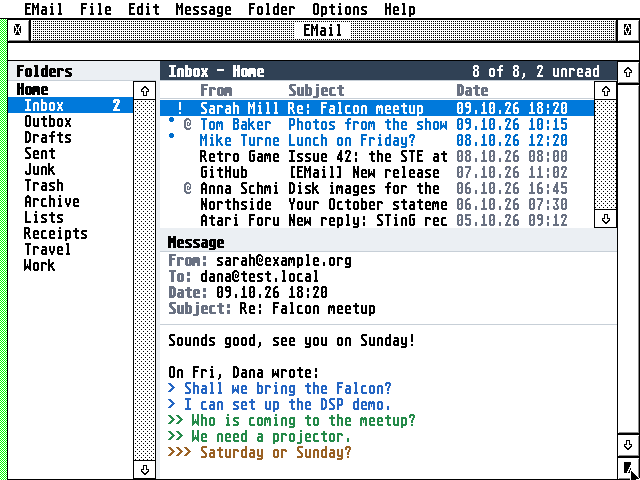

# EMail


An e-mail program for the Atari ST, STE, TT and Falcon, written in C for GEM.

**Highlights**

- **IMAP and POP3 in, SMTP out**, with an Outbox, a mirror on disk for working offline, and Find as you type.
- **Secure on any Atari:** through the Gateway (a Raspberry Pi), or a Direct connection with TLS 1.2 on a
  Falcon or TT, RSA on the Falcon's DSP.
- **Hebrew throughout:** right-to-left layout, the Israeli keyboard on F10, Hebrew in vector fonts through NVDI.
- **Translate** messages, or a few chosen words, with the Gateway's translation service on your own network.
- **EMail check**, a small accessory, tells you about new mail while EMail isn't running.



## Getting started

**Needs:** TOS 1.04 or newer (TOS 4 on the Falcon), EmuTOS, MagiC or MiNT; 640×200 or larger; 1 MB of
memory (EMail takes about 332 KB); STinG, STiK, MiNTnet or MagiC-Net; and for encrypted mail (nearly all
providers) the Gateway or a Direct connection (a Falcon or TT with 4 MB).

Download the files from the **[latest release](https://github.com/whomper/EMail/releases/latest)**, one by
one or all together in `EMAIL-x.y.zip`:

| File | What it is |
|---|---|
| `EMAIL.PRG` | the program, for every Atari |
| `EMAIL.HYP`, `EMAIL.REF` | the user guide, opened by the Help key |
| `TLS.OVL`, `CACERT.PEM`, `ROOTS.DAT` | a Direct connection on a TT or Falcon: TLS and the root certificates |
| `EMAILCHK.ACC` | EMail check, the new-mail accessory (optional) |
| `EMAIL.RSC`, `EMAILNV.RSC`, `*.ICN` | the desktop icon ([which one](docs/GUIDE.md#the-desktop-icon)) |

1. Copy `EMAIL.PRG`, `EMAIL.HYP` and `EMAIL.REF` to a folder of their own, such as `C:\EMAIL\`.
2. Set up the Gateway on a Raspberry Pi with [AERA-Gateway](https://github.com/whomper/AERA-Gateway):

   ```
   sudo apt install -y git && git clone https://github.com/whomper/AERA-Gateway ~/AERA-Gateway &&
     ~/AERA-Gateway/update-pi.sh --allow ATARI_IP --mail IMAP_SERVER SMTP_SERVER[:587] [POP3_SERVER]
   ```

   Or, on a Falcon or TT, copy `TLS.OVL`, `CACERT.PEM` and `ROOTS.DAT` beside `EMAIL.PRG` and switch on
   **Options > Direct connection**.
3. Start EMail and fill in your account in **Options > Accounts**. Gmail, iCloud, Yahoo and Fastmail need
   an [app password](docs/GUIDE.md#app-passwords-gmail-icloud-yahoo-fastmail).
4. Press **Help** for the [user guide](docs/GUIDE.md).

To update, copy the new files over the old ones. Every step and tip: [docs/DETAILS.md](docs/DETAILS.md).

## How it reaches the servers

```
ST, STE:     Atari (EMAIL.PRG) --plain, home LAN--> Raspberry Pi (emailgate.py) --TLS--> provider
Falcon, TT:  Atari (EMAIL.PRG + TLS.OVL: TLS 1.2, RSA on the DSP) ---------------TLS--> provider
```

Speeds and details: [docs/DETAILS.md](docs/DETAILS.md#how-it-reaches-the-servers).

## Building

```sh
sudo apt install gcc-m68k-linux-gnu python3   # no MiNTLib needed
make                                          # binary/: EMAIL.PRG, EMAILCHK.ACC and the rest
make help HCP=/path/to/hcp                    # the help file from docs/GUIDE.md
make dist HCP=/path/to/hcp                    # the release files and the zip
```

Releases, `TLS.OVL` and the DSP code: [docs/DEVELOPING.md](docs/DEVELOPING.md).

## Source

```
src/      the mail core: IMAP, POP3, SMTP, MIME, the local store
ui/       the GEM program; emailchk.c is EMAILCHK.ACC
atari/    EMail's own part of the TOS runtime
common/   code shared with the other AERA programs (from AERA-Atari)
gateway/  the Raspberry Pi gateways, a copy of AERA-Gateway's
tests/    unit, fuzz and integration tests, the Hatari rigs
tools/    the help file, syncing, releases, TLS measurements
docs/     the user guide and the pictures
```

## Tests

```sh
make test                  # charsets, MIME, bidi, the fuzz inputs, the gateway's tests
make itest                 # IMAP, POP3, SMTP against a local Dovecot (TLS=1, FALCON=1 too)
tests/hatari/net_test.py   # EMAIL.PRG in the Hatari emulator; every rig: docs/DEVELOPING.md
```

## Licence

GPL 2 or later: see [COPYING](COPYING). Copyright (C) 2026 AERA | Erez Yaary. It includes
[BearSSL](common/third_party/bearssl) (MIT) and Mozilla's root certificates (MPL 2.0).

---

Part of **AERA** for Atari: [ECal](https://github.com/whomper/ECal) · [EContact](https://github.com/whomper/EContact) · [EMail](https://github.com/whomper/EMail) · [EFTP](https://github.com/whomper/EFTP) · [EHypView](https://github.com/whomper/EHypView) · [ClaudeST](https://github.com/whomper/ClaudeST) · [EWeb](https://github.com/whomper/EWeb) · [EUpdate](https://github.com/whomper/EUpdate) · 8-bit: [EDOS](https://github.com/whomper/EDOS) · [EFTP_XL](https://github.com/whomper/EFTP_XL) · Gateway: [AERA-Gateway](https://github.com/whomper/AERA-Gateway)
