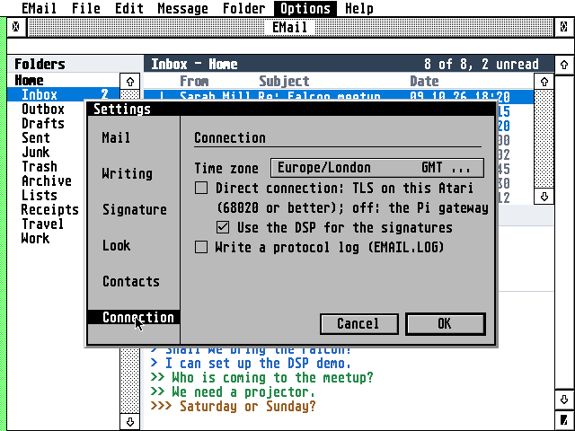

<!-- SPDX-License-Identifier: GPL-2.0-or-later -->
<!-- Copyright (C) 2026 AERA | Erez Yaary -->
# EMail in more detail

What used to be on EMail's front page (README) and isn't in the [user guide](GUIDE.md): the features
one by one, setting up the Gateway step by step, the TOS and STinG tips, and how fast a Direct
connection is. The guide (the Help key in EMail) describes how to use it all.

## Highlights, in full

- **IMAP and POP3 in, SMTP out,** with an Outbox for sending later and copies in Sent.
- **Secure, two ways:** the Gateway (a Raspberry Pi) for any Atari, or a **Direct connection**, with TLS 1.2 on the
  Atari itself and RSA on the Falcon's DSP.
- **Hebrew throughout:** UTF-8, ISO-8859-8 and windows-1255 mail, right-to-left layout, the Israeli
  keyboard on F10, Hebrew in vector fonts through NVDI.
- **Works offline:** a mirror of your folders and the messages you've read on disk. Read, flag and move
  offline; the server catches up later.
- **Fast checks:** one go fetches the Inbox and asks every other folder for its counts, so new mail
  filed in Junk or by server rules shows up too.
- **Many messages at once:** select several and mark them read or unread, flag, move or delete them
  together.
- **Find:** Ctrl+F narrows the message list to what you type, by sender or subject, as you type; **Search
  server** looks through the messages' text on the IMAP server too.
- **Folders:** create, rename and delete; an alphabetical folder picker for moving messages.
- **Translate:** Options > Translate shows each message translated by the Gateway's translation service, on
  your own network; a right-click on chosen words translates just those. Settings > Connection >
  Languages... chooses which languages the Gateway has installed.
- **New mail while EMail isn't running:** EMail check (`EMAILCHK.ACC`), a small desk accessory, looks
  in each account's Inbox as often as EMail would and says how many new messages have come; under MiNT
  with BGEM.NG, new mail is a notification with Open and Later, from EMail check and from EMail itself
  while its window is behind.
- **Links that open:** web addresses and an HTML message's links are underlined; a click opens one in
  EWeb (or CAB or HighWire), a `mailto:` one as a new message.
- **Modern but Atari:** one window with draggable panes, right-click menus, colour on 16- and 256-colour
  screens, a Settings dialog with a sidebar, progress on the status line, the guide on the Help key.
- **Any Atari:** TOS 1.04 to 4.x, EmuTOS, MagiC and MiNT, with STinG or MiNTnet, from a 68000 ST in
  medium resolution to a Falcon in 640×480. It runs in TT RAM when the machine has some.

## Setting up the Gateway, step by step

2. Set up the gateway on a Raspberry Pi from [AERA-Gateway](https://github.com/whomper/AERA-Gateway),
   which brings it to its latest release, with your provider's servers and your Atari's address. On a
   fresh Pi, one line sets up every AERA gateway (the other AERA programs' too):

   ```
   sudo apt install -y git && git clone https://github.com/whomper/AERA-Gateway ~/AERA-Gateway &&
     ~/AERA-Gateway/update-pi.sh --allow ATARI_IP --mail IMAP_SERVER SMTP_SERVER[:587] [POP3_SERVER]
   ```

   Or step by step, the mail gateway alone:

   ```
   sudo apt install -y git                  (Raspberry Pi OS Lite only)
   git clone https://github.com/whomper/AERA-Gateway
   cd AERA-Gateway
   ./update-pi.sh
   sudo gateway/aera-gateway install mail IMAP_SERVER SMTP_SERVER[:587] [POP3_SERVER] --allow ATARI_IP
   ```

   For example `install mail imap.gmail.com smtp.gmail.com pop.gmail.com --allow 192.168.1.20`; iCloud is
   `imap.mail.me.com smtp.mail.me.com:587` (AERA-Gateway's README has the others). `--allow` lets only
   your Atari in; without it, any computer on your home network may use the gateway.
   After `update-pi.sh` has run once, `sudo aera-gateway` works too, from any folder.
   To update: `cd ~/AERA-Gateway && ./update-pi.sh`. To check: `gateway/aera-gateway status`.

Once it runs, fill in your account in **Options > Accounts**: the Gateway's IP address (`PI_IP`;
`aera-gateway` prints it) as the server, port 143 for IMAP (110 for POP3) and 587 for SMTP. For Gmail,
iCloud, Yahoo and Fastmail the password is an app password: the guide's
[App passwords](GUIDE.md#app-passwords-gmail-icloud-yahoo-fastmail).

### App passwords (Gmail, iCloud, Yahoo, Fastmail)

These services refuse the password you use on their website when a program like EMail logs in. Make an
**app password** on the service's website, once, and type it into EMail's Password field, for the
incoming and the outgoing mail, in place of your normal password. Your normal password stays as it is,
and you can delete the app password there at any time.

| Service | First | Where to make it | User in EMail |
|---------|-------|------------------|---------------|
| Gmail | 2-Step Verification on | https://myaccount.google.com/apppasswords (16 letters: type them without the spaces) | your Gmail address |
| iCloud | two-factor authentication | https://account.apple.com, Sign-In and Security, App-Specific Passwords ([Apple's help](https://support.apple.com/en-us/102654)) | incoming: the name before @icloud.com (or the whole address); outgoing: the whole address |
| Yahoo | | Account Security, Create app password under "External connections" ([Yahoo's help](https://help.yahoo.com/kb/SLN15241.html)) | your Yahoo address |
| Fastmail | not the Basic plan | Settings, Privacy & Security, Manage app passwords and access ([Fastmail's help](https://www.fastmail.help/hc/en-us/articles/360058752854)) | your Fastmail address |

On a Falcon or TT with 4 MB you can skip the Gateway: copy `TLS.OVL`, `CACERT.PEM` and `ROOTS.DAT` next to
`EMAIL.PRG` and switch on **Options > Direct connection**. EMail fills in the servers for the big providers.

## Updating

**Updating:** copy the new release's files over the old ones. `EMAIL.INF`, `EMAIL.KEY` and your mail stay
as they are. Coming from 1.55 or before on an ST, delete `EMAILST.PRG`: `EMAIL.PRG` is for every Atari now. On the Gateway, `./update-pi.sh` in `AERA-Gateway` updates it.

## What it needs, in full

**Needs:** TOS 1.04 or newer (TOS 4 on the Falcon), EmuTOS, MagiC or MiNT; 640×200 (ST medium) or
larger; 1 MB of memory (EMail itself takes about 332 KB, and about 140 KB more on a TT or Falcon while
`TLS.OVL` is loaded for a Direct connection; more memory holds bigger folders; the accessory EMail check about 180 KB more), 2 MB or more with
EContact's accessory (on a 1 MB ST, use EContact as a program, `ECONTACT.PRG`); network: STinG (or STiK), MiNTnet or
MagiC-Net; for providers that need encryption (nearly all), the Gateway or a Direct connection (a
Falcon or TT, a 68020 or better, with 4 MB or more).

**Under TOS, put Atari's `FOLDR100.PRG` first in `AUTO`**, renamed for more room (`FOLDR400.PRG`).
TOS keeps an entry in a small internal pool for every folder a program or accessory has looked
into, and halts with "OUT OF INTERNAL MEMORY" when it runs out; FOLDRxxx makes the pool bigger.

**With STinG, set the Delay in `STING.CPX` to suit the machine:** 10 on a
Falcon or TT, 25 to 50 on an ST, as STinG's manual says. STinG looks at the network card that
often, so it sets the speed of every STinG program: on Erez's Falcon with a NetUSBee, Delay 10
took EFTP's downloads from 40 to 75 KB/s.

## Features

- A folder's messages in one file on disk, written in one go at the end of a check or a download (few
  file opens on an Atari hard disk); a message cut short by a reset is fetched again
- IMAP with a local mirror: headers of the newest messages and every message you've read, kept in step
  with the server; big folders load 100 messages at a time, with "Load more" for older ones. Read and
  flag changes are sent in one go when you pause, and at the latest on quit
- POP3 that downloads into local folders and never fetches a message twice
- SMTP with login (AUTH PLAIN/LOGIN); Send now goes straight out, with anything waiting in the Outbox
- Reply, reply to all, forward (with the original's attachments), flags, move (or drag messages onto a
  folder), delete to Trash, mark a whole folder read, one signature of up to four lines for every account
- People by name from EContact, the AERA address book: in the list, the message and the To: line,
  with the address in a tooltip; Ctrl+B picks people and groups in EContact's window. Where EContact
  runs only now and then (short of memory), EMail can read its `CONTACTS.TXT` instead (Settings > Contacts)
- Attachments: save them with the file selector; attach files when writing
- Calendar invitations go to ECal, the AERA calendar: double-click one and ECal's New Event dialog
  opens filled in from it
- HTML-only mail shown as text
- Dates with the year, numbers with thousands separators
- Fonts: the system font in two sizes and any monospaced GDOS font (bitmap, Speedo, TrueType); the
  selector lists only the fonts EMail can use. A vector font's Hebrew letters are found through NVDI 5
  by Unicode (FreeMono and Liberation Mono have them); a font without them gets its Hebrew drawn in the
  system font
- Your time zone by name (Asia/Jerusalem, Europe/London...), with summer time worked out by itself and
  found from the machine when it says
- Passwords encrypted in `EMAIL.INF`, hidden behind an eye button in the dialogs
- Dialog fields that hold more than they show: a long name, address, signature line or folder scrolls
  in its field
- A crash in EMail is caught: an alert, `CRASH.LOG` with what happened, and the Atari keeps running
- `EMAIL.INF` in capitals, each setting with a note above it



## How it reaches the servers

Mail providers want encrypted connections. EMail reaches them one of two ways, switched with
**Options > Direct connection**:

```
ST, STE:     Atari (EMAIL.PRG) --plain, home LAN--> Raspberry Pi (emailgate.py) --TLS--> provider
Falcon, TT:  Atari (EMAIL.PRG + TLS.OVL: TLS 1.2, RSA on the DSP) ---------------TLS--> provider
             (a Direct connection; or through the Gateway, as an ST)
```

- **Off** (the default), on any Atari: the Gateway, a Raspberry Pi on your network, does the encryption.
  `gateway/emailgate.py` is standard Python, set up as a service by `gateway/aera-gateway`. A server that
  accepts plain connections can be used directly.
- **On**, a Direct connection, on a Falcon or TT with 4 MB or more (TT RAM helps): EMail does TLS 1.2
  itself with `TLS.OVL`, the family's file of [BearSSL](https://bearssl.org/) and the Falcon's DSP code,
  built for the 68030 in AERA-Atari (`common/tlsovl`) and loaded the first time it is needed; the
  DSP56001 checks the servers' RSA signatures. It needs `TLS.OVL`, `CACERT.PEM` and `ROOTS.DAT` next to
  `EMAIL.PRG`. See [Direct connection](GUIDE.md#direct-connection) in the guide.

Each account keeps separate server settings for the gateway and for the Direct connection, so switching
between them keeps both.

The gateway's own README, with every provider and option: [AERA-Gateway](https://github.com/whomper/AERA-Gateway)
(the same text is in this repository's copy, [gateway/README.md](../gateway/README.md)).

## Performance: Gateway, 68030 and DSP

What costs time is the TLS handshake, once per connection: EMail keeps its IMAP connection open, so that
is once per session, plus once for each batch of mail sent.

| | Gateway | Direct connection, 68030 only | Direct connection, 68030 + DSP |
|---|---|---|---|
| Machines | any Atari, 68000 ST too | Falcon, TT (68030) | Falcon |
| Handshake, stock 16 MHz Falcon | done by the Gateway, a fraction of a second | about 9.6 s | about 2.5 s |
| Handshake, 50 MHz Falcon in TT/fast RAM | done by the Gateway | about 5 s | about 1.5 s |
| Mail coming in, once connected | about 37 KB/s | 15 to 25 KB/s on a 50 MHz Falcon (the cipher alone: 39 KB/s at 16 MHz, 66 KB/s at 50 MHz in fast RAM) | the same: the DSP only helps the handshake |
| Work on the Atari | none, plain IMAP/SMTP | all of TLS | TLS, RSA checks on the DSP |

In a handshake the 68030 does the key exchange (X25519, 0.5 to 1 s each, two of them) and the DSP56001
the three RSA-2048 certificate checks (about 0.12 s each instead of 1.3 to 2.5 s). Running from TT/fast
RAM matters as much as the clock: ST RAM is 16 bits wide and shared with the video, so EMail loads
itself into TT RAM when there is some (the About box says where it runs). A 68000 ST has no chance of
TLS in reasonable time and always goes through the Gateway.

The 50 MHz figures were measured on a real Falcon with a DFB1X board, the 16 MHz ones in cycle-exact
emulation; details in [tools/tlsbench](../tools/tlsbench/README.md).

## Credits

EMail has four windows (folders, message list, message, editor), mirrors IMAP folders, and works over
STinG or MiNTnet. It reuses parts of [ClaudeST](https://github.com/whomper/ClaudeST): the freestanding TOS runtime, GEM
bindings, STinG client, Hebrew right-to-left layout and keyboard, and the Hatari test tools.
